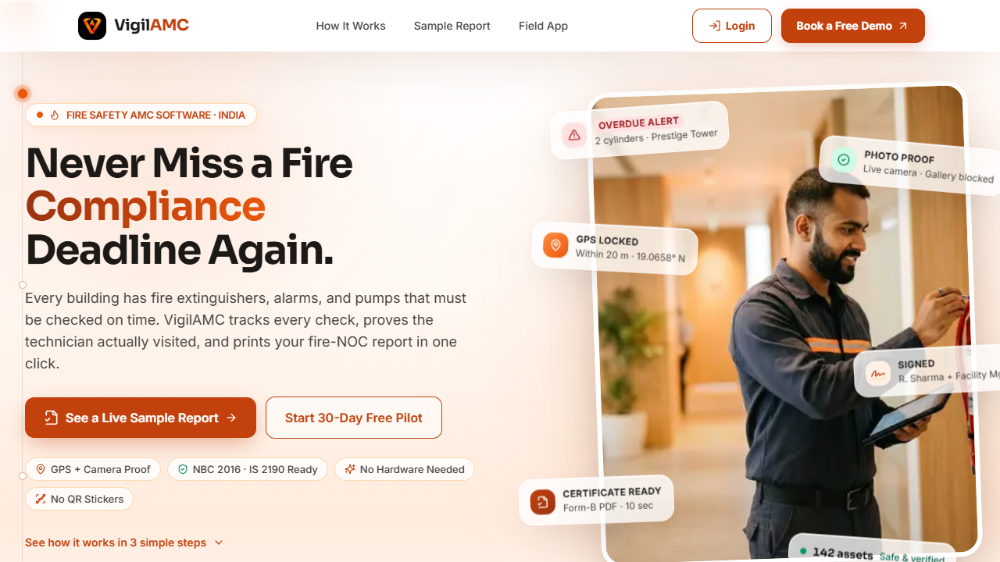
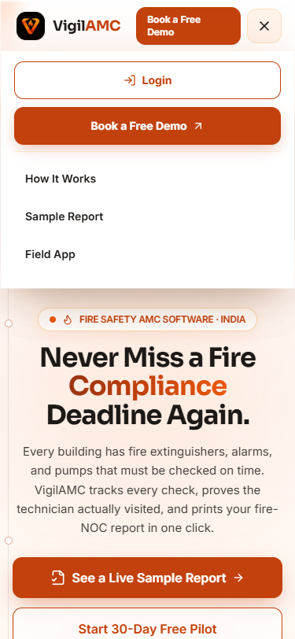
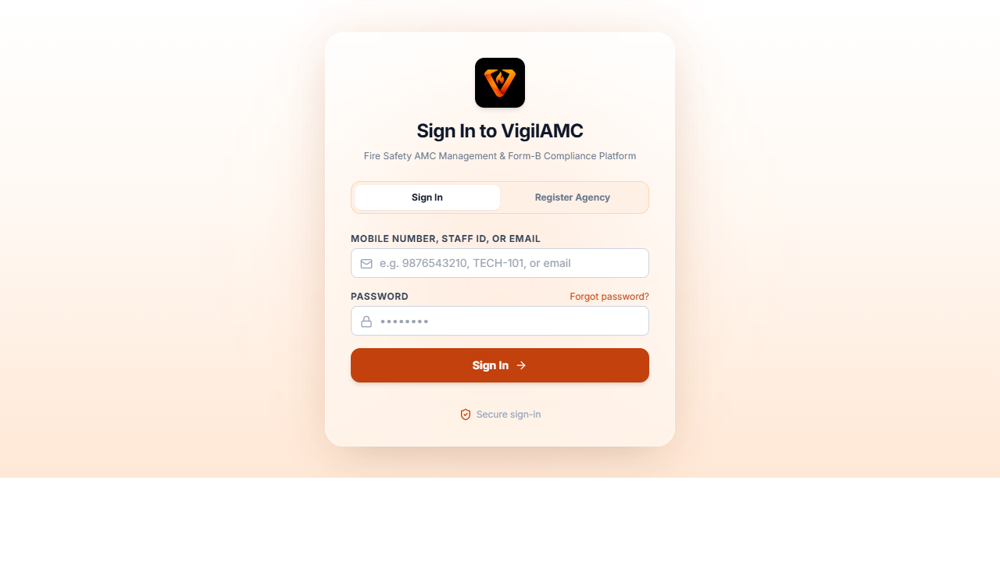
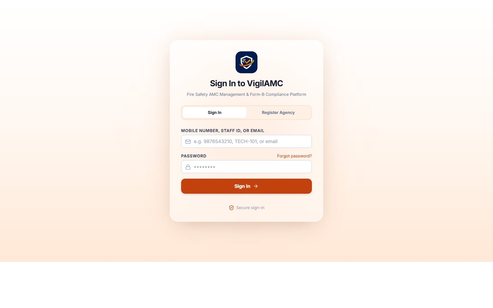
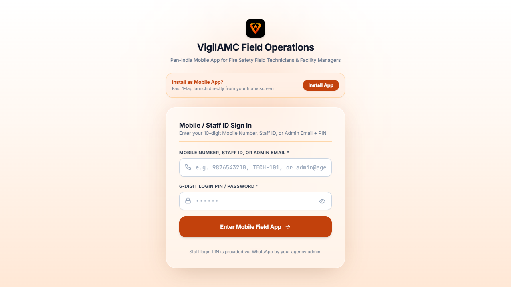

# AGENTS.md — VigilAMC (read before every task) [CHANGED: SINGLE-BRAND FIRE + GLASS + SCROLL-CRAFT]
Live site: https://vigilamc.vercel.app
Stack: Next.js App Router + TypeScript + Tailwind CSS + Prisma + Supabase Auth + PostgreSQL + Cloudflare R2 + Vercel.

## Commands
- Build: `npm run build` (MUST pass with zero errors before every push)
- Dev: `npm run dev` — Lint: `npm run lint` (if configured)

## Hard rules (a violation = the task failed) [CHANGED: FULL FIRE ROLLOUT]
1. **API contract:** every `fetch("/api/...", {method})` in UI code must have a matching exported handler (GET/POST/PATCH/PUT/DELETE) in the corresponding `app/api/**/route.ts`. Before finishing, grep each changed fetch AND its route file. A method mismatch (405) is a production bug — this bug already happened once with PATCH /api/work-orders.
2. **No silent failures:** every `catch` must (a) show user-visible feedback (toast/banner) and (b) leave no stale optimistic UI — revert to the previous state and re-fetch. `console.error` alone is banned.
3. **Prisma safety:** convert empty form strings to `null` before saving ("" for dates/ids crashes Prisma). Validate enum values against schema.prisma. Scope every query by companyId/tenant.
4. **Secrets:** NEVER commit .env / .env.local / credentials or hardcode keys, tokens, passwords. Check `git diff` for secrets before every push.
5. **Design system [CHANGED: SINGLE-BRAND FIRE + GLASS PANEL SYSTEM]:** FIRE palette is the single brand across ALL surfaces (marketing + product). Tokens: flame #EA580C (#C2410C hover, #9A3412 active), ember #FF8C42, charcoal-ink #1C1917, charcoal-body #44403C, bg #FFFFFF / #FFF8F2, signal semantics #DC2626 / #D97706 / #059669 / #64748B. Glass Panel System tokens: glass-fill rgba(255,255,255,0.45) (0.55 where text-heavy), glass-blur backdrop-filter: blur(18px) saturate(1.15) (12px mobile), glass-border 1px solid rgba(255,255,255,0.55) + inset 0 1px 0 rgba(255,255,255,0.85), glass-shadow 0 24px 60px -24px rgba(28,25,23,0.18), glass-ember-glow 0 0 60px rgba(232,89,12,0.12) with radial ember glows behind glass panels. Motion: scroll-scrubbed hero depth planes + Ember Line scroll-progress signature + IO section reveals + counters; prefers-reduced-motion fully supported; transforms/opacity only; CLS 0. /manifest.json + /sw.js remain untouched (field PWA exception). Dark themes, bg-slate-950, and retired blue (#0077B6 / #023E8A / #F4F8FB) remain banned everywhere (dark: variants banned too).
6. **No QR codes anywhere** in product, reports or docs — use GPS + Asset Tag ID + Floor/Zone checklists + camera photo proof instead. No hero video (brag.mp4 stays dead).
7. **Pan-India UI:** icon-first design, NO English/Hindi language toggle; support the browser voice-to-text mic for remarks.
8. **Definition of done (every change):** `npm run build` clean -> push to GitHub WITHOUT secrets -> VERIFY LIVE on https://vigilamc.vercel.app (curl the changed endpoints + pages and report HTTP codes) -> report results. Never stop at localhost.
9. **Numbers/KPIs:** guard null dates; use explicit time windows; NEVER fall back to all-time counts when a window count is 0; show "No due date set" instead of NaN.
10. **No regressions:** never break /dashboard, /technician, /report/[buildingId], /login, or the public site when editing shared code. After changes, confirm these routes return HTTP 200.

## Vocabulary (check schema before assuming)
Work Order status: OPEN | ASSIGNED | IN_PROGRESS | COMPLETED | CANCELLED.
Equipment status: VERIFIED | DUE_SOON | OVERDUE | SERVICE_REQUIRED | REPLACEMENT_REQUIRED.

## Live Verified Surface Screenshots (Up-to-Date — VIGILAMC FIRE + Lit-Glass + V-Flame Brand Logo)
- **Homepage Hero (Desktop 1440×900 — Up-to-Date):** `docs/screenshots/hero-desktop-1440x900.png`
  
- **Homepage Hero (Mobile 375×812 — Up-to-Date):** `docs/screenshots/hero-mobile-375x812.png`
  
- **Login Agency Card (`/login` 1440×900 — Up-to-Date V-Tile):** `docs/screenshots/login-fire-1440x900.png`
  
- **Admin Dashboard (`/dashboard` — Up-to-Date FIRE + Glass Theme):** `docs/screenshots/dashboard-fire-1440x900.png`
  
- **Field Technician App (`/technician` — Up-to-Date FIRE + Glass Theme):** `docs/screenshots/technician-fire-375x812.png`
  
